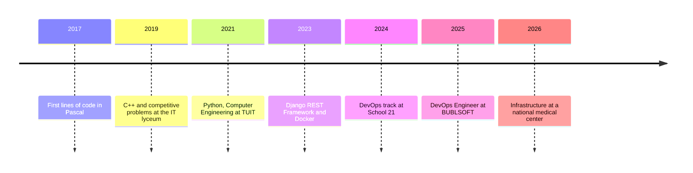
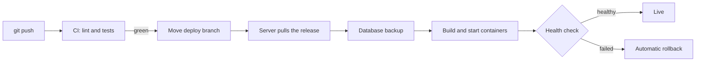

📍 Tashkent, Uzbekistan 🇺🇿

## About

I build backend systems with Python and Django, then take them all the way to production: containers, CI/CD, reverse proxies and backups on servers I set up myself.

I've been writing code since 2017, starting with Pascal at school. I hold a Bachelor's in Computer Engineering from TUIT and went through the DevOps track at School 21.

## Experience

| Role | Where | When |
|---|---|---|
| **DevOps / Infrastructure Engineer** | Republican Medical Center (Oncology & Radiology) | 2026 – present |
| **DevOps Engineer** | BUBLSOFT LLC | 2025 – 2026 |
| **Backend Developer** | Freelance | 2023 – 2025 |

## My journey

## Tech stack

  

  

## Selected work

| Project | What it is | Built with |
|---|---|---|
| **K-ONE** · private | Event management system: planning, approvals, QR check-in, reports, Telegram notifications | Django, PostgreSQL, Redis, Docker |
| [**Oncoscience**](https://github.com/KarimovProject/Journal_cancercenter) | Academic journal platform for an oncology center, in three languages | Django, DRF, PostgreSQL |
| [**abdullatif.uz**](https://abdullatif.uz) | Personal portfolio, running on my own server | HTML, Docker, Nginx |

## How I ship

The deploy pipeline behind K-ONE: nothing reaches production without green tests, and a failed release rolls itself back.

## Now learning

Deeper monitoring with Prometheus, then Kubernetes and Terraform.

## GitHub activity

